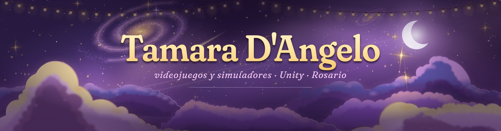
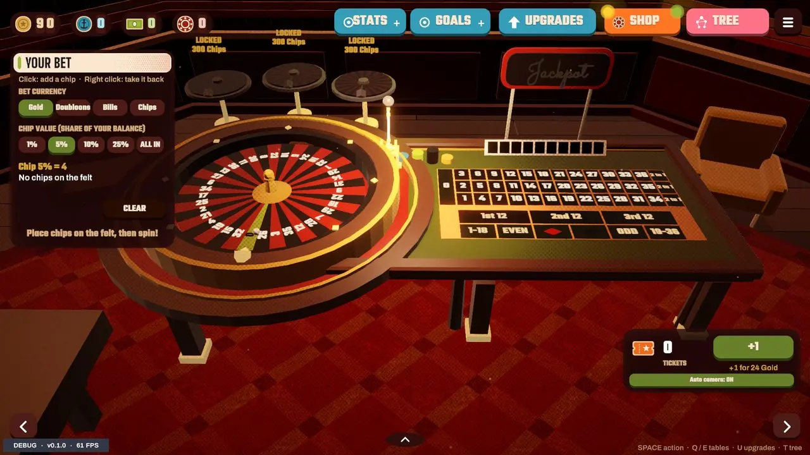
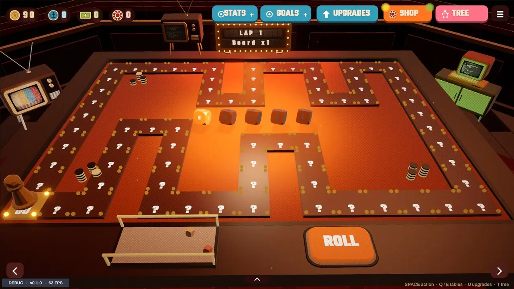
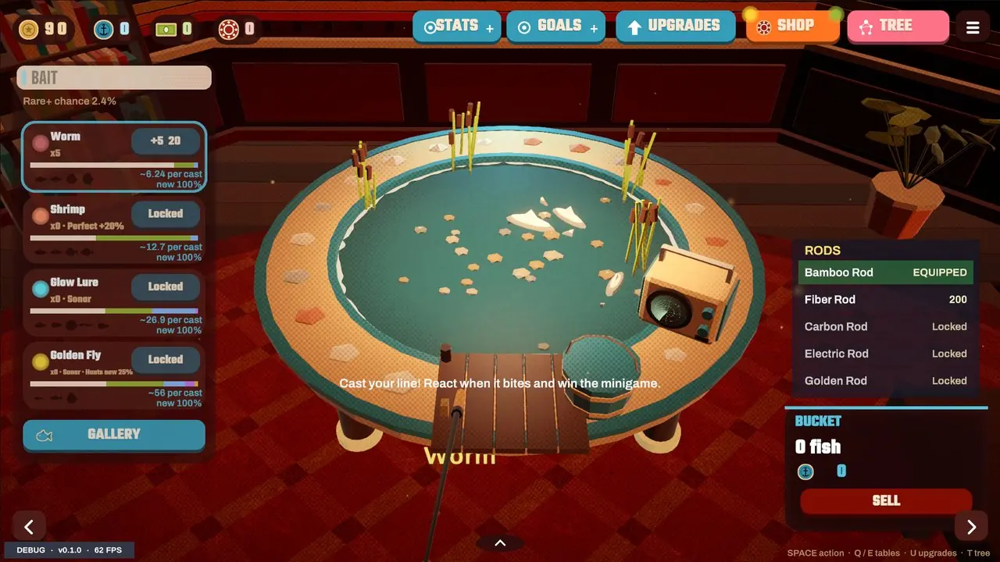
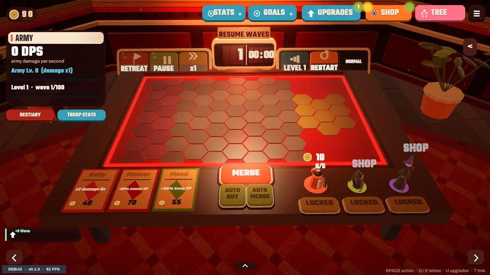

<!-- Perfil de GitHub de Tamara. Repo: Tamara1001/Tamara1001 (público) -->

 

📫 **Disponible para oportunidades** en desarrollo de videojuegos y simuladores. Escribime a [contactotamara1001@gmail.com](mailto:contactotamara1001@gmail.com).

<b>🇬🇧 English version</b>

 

### Hi, I'm Tamara

📫 **Open to opportunities** in game and simulation development. Reach me at [contactotamara1001@gmail.com](mailto:contactotamara1001@gmail.com).

- 🎮 Studying **Simulator and Video Game Production**. I program in **Unity (C#)**.
- 🧪 I love **simulators**: physics, reactive systems, and tools that actually teach something.
- 📺 I **stream** on Twitch.
- 🌱 I'm learning **web development** and **Android apps**, and I know a bit of **Python**.
- 🏆 I take part in **game jams**: *Still Typing...* was born at the Women Game Jam 2026.
- 📍 Based in **Rosario, Argentina**.

### Featured projects

| Project | What it is | Stack |
|---|---|---|
| [**DopamineMaxxing**](https://dopaminemaxxingweb.vercel.app/) · [play](https://tamara1001.itch.io/dopaminemaxxing) | A tabletop incremental: roulette, dice board, fishing and an army that fights on its own while you play something else. Four casino-style minigames at once, with an upgrade tree. Free in the browser. | Unity · C# · WebGL |
| [**SpellSimulator**](https://github.com/Tamara1001/SpellSimulator) · [play](https://tamara1001.itch.io/spellsimulator) | A spell sandbox: you draw runes, a local neural network recognizes them and the world reacts with physics. Online multiplayer, 1v1 duels, built with VR in mind. Based on cosykid's fan project. | Unity 6 · C# · Sentis · Netcode |
| [**LOTO Simulator**](https://github.com/Tamara1001/Capacitacion) · [play](https://tamara1001.itch.io/capacitacion-loto) | 3D workplace-training demo on lockout/tagout of hazardous energy, with guided and assessment modes. | Unity 6 · C# · Blender · WebGL |
| [**Still Typing...**](https://github.com/Tamara1001/StillTyping) · [play](https://tamara1001.itch.io/stilltyping) | 2D narrative game for the Women Game Jam: build sentences under pressure to learn to say no. Tested with automated bots. | Unity 6 · C# · WebGL |
| [**Fish or Die**](https://github.com/Tamara1001/FishOrDie) · [play](https://tamara1001.itch.io/fishordie) | Local party game for 2 to 6 players, one key each. Drop-in lobby and dynamic music. | Unity 2D · C# · Input System |
| [**3D Ballistic Simulator**](https://github.com/Tamara1001/SimuladorBalistica) · [play](https://tamara1001.itch.io/simuladorbalistico) | Projectile physics with destructible structures, MVC architecture and cloud persistence. | Unity · C# · UGS |

### Currently learning
🌐 Web development (React) · 📱 Android apps (.NET MAUI, C#) · 🐍 Python

---

## ✨ Sobre mí

- 🎮 Estudio **Producción de Simuladores y Videojuegos** y programo en **Unity (C#)**.
- 🧪 Me enamoran los **simuladores**: física, sistemas que reaccionan y herramientas que enseñan algo de verdad.
- 📺 Hago **streams** en Twitch.
- 🌱 Estoy aprendiendo **desarrollo web** y **apps Android**, y sé un poquito de **Python**.
- 🏆 Participo en **game jams**: *Still Typing...* nació en la Women Game Jam 2026.
- 📍 Vivo en **Rosario**, Argentina.

## 🚀 Proyectos destacados

| | Proyecto | Qué es | Stack |
|:-:|---|---|---|
| 🎰 | [**DopamineMaxxing**](https://dopaminemaxxingweb.vercel.app/) · [jugar](https://tamara1001.itch.io/dopaminemaxxing) | Incremental de mesa: ruleta, tablero de dados, pesca y un ejército que pelea solo mientras jugás otra cosa. Cuatro minijuegos de salón a la vez, con árbol de mejoras. Gratis en el navegador. | Unity · C# · WebGL |
| 🪄 | [**SpellSimulator**](https://github.com/Tamara1001/SpellSimulator) · [jugar](https://tamara1001.itch.io/spellsimulator) | Dibujás runas, una red neuronal local las reconoce y el mundo reacciona con físicas. Multijugador en red, duelo 1v1 y pensado para VR. Basado en el proyecto fan de cosykid. | Unity 6 · C# · Sentis · Netcode |
| 🏭 | [**Simulador LOTO**](https://github.com/Tamara1001/Capacitacion) · [jugar](https://tamara1001.itch.io/capacitacion-loto) | Demo 3D de capacitación laboral: bloqueo y etiquetado de energías peligrosas, con modo guiado y de evaluación. | Unity 6 · C# · Blender · WebGL |
| 💬 | [**Still Typing...**](https://github.com/Tamara1001/StillTyping) · [jugar](https://tamara1001.itch.io/stilltyping) | Aventura narrativa 2D para la Women Game Jam: armás frases bajo presión para aprender a decir que no. Testeada con bots. | Unity 6 · C# · WebGL |
| 🎣 | [**Fish or Die**](https://github.com/Tamara1001/FishOrDie) · [jugar](https://tamara1001.itch.io/fishordie) | Party game local para 2 a 6 jugadores con una sola tecla por persona. Lobby drop-in y música dinámica. | Unity 2D · C# · Input System |
| 🎯 | [**Simulador Balístico 3D**](https://github.com/Tamara1001/SimuladorBalistica) · [jugar](https://tamara1001.itch.io/simuladorbalistico) | Física de proyectiles con estructuras destructibles, arquitectura MVC y persistencia en la nube. | Unity · C# · UGS |

  
  
  
  

## 🌱 Lo que estoy aprendiendo

Además de juegos, me estoy metiendo en otras áreas:

- 🌐 **Desarrollo web**, con React.
- 📱 **Apps Android**, con .NET MAUI y C#.
- 🐍 **Python**, un poquito, para scripts y automatizaciones.

## 🧰 Con qué trabajo

**Aprendiendo:** desarrollo web (React) · apps Android (.NET MAUI)

**Prácticas:** arquitectura por eventos · ScriptableObjects · tests automáticos y bots · builds WebGL · documentación de producción

## 📊 Mi actividad

  

---

